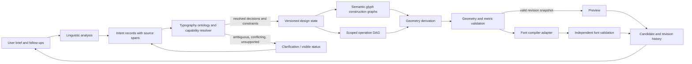

# Universal Typeface Design Model and Operation Contract

Status: design proposal, version `2.0-draft`, with an executable transactional integration under `integration-experiment/`. The model and executor remain isolated from the application and do not change the current generator or production release.

## Goals and boundaries

The model separates five things that the current prototype partly combines:

1. **Intent**: what the user said and what kind of request it expresses.
2. **Resolved design state**: accepted characteristics and constraints, with their source and certainty.
3. **Semantic construction**: glyph anatomy and relationships independent of outline coordinates.
4. **Operations**: scoped, ordered changes to state, construction, geometry, or metrics.
5. **Derived artifacts**: contours, metrics, compiled fonts, and validation reports produced from a revision.

The model does not claim that every English request is implementable. It must preserve every material instruction and label it as implemented, approximate, unsupported, ambiguous, conflicting, or awaiting a decision. A valid model can therefore contain unresolved intent; unresolved intent must not be silently converted into a default.

The three current construction systems are optional seed-design identifiers. They are not values required by this contract and are not the engine's top-level algorithm selector.

## Data flow and subsystem boundaries



NLP does not own typography semantics; the resolver does not construct outlines; construction and operations produce geometry; the compiler consumes a frozen validated geometry snapshot. A clarification re-enters interpretation with the user's answer as an explicit message. Each derived artifact records the design revision and engine/compiler versions that produced it.

Writing-system and layout concerns are specified in the separately versioned [Writing Context and Shaping Extension](./writing-context.md). They are not folded into a single `direction` scalar or into glyph identity. This extension is still a proposal and does not change the application or integration experiment.

The isolated [shaping-request adapter](./shaping-request-adapter.mjs) turns an accepted design snapshot and already-resolved layout context into a non-rendering external request. Its fixtures and tests are separate from the prototype and integration experiment.

## Document envelope

```json
{
  "type": "lfcfoundry.universal-typeface-design",
  "schemaVersion": 2,
  "designId": "design:...",
  "family": { "name": "...", "unitsPerEm": 1000 },
  "input": { "brief": "...", "language": "en", "messages": [] },
  "intent": { "statements": [] },
  "state": { "characteristics": [], "constraints": [], "decisions": [] },
  "glyphRegistry": { "revisionId": "rev:...", "glyphs": [] },
  "selectors": [],
  "operations": [],
  "revisions": { "acceptedRevisionId": "rev:...", "headRevisionId": "rev:...", "items": [] },
  "derived": { "geometry": null, "fontArtifacts": [], "validation": [] }
}
```

The v2 draft envelope remains the typeface design document. Writing support is an independently versioned optional subdocument (`writingSupport.version: 1`); a shaping/layout request is a separate object and is not persistent design state unless saved as a specimen or test case. See the writing-context contract for the full distinction and fixtures.

All IDs are stable, opaque strings scoped to the design (for example `glyph:u006f`, `op:heart-o-1`). Unicode is an identity mapping, not the glyph's sole identity: one glyph may have multiple Unicode mappings, and a glyph can have no Unicode mapping. IDs must not be regenerated when a glyph is edited or reconstructed. Coordinates and metrics use integer font units at export boundaries; the model records units explicitly.

### Intent statement

An intent statement preserves the user's words separately from the interpretation:

```json
{
  "id": "intent:3",
  "kind": "style-reference | characteristic | construction | substitution | transformation | metric | preservation | exclusion",
  "subject": { "scope": "family | class | glyph | codepoint", "selectorId": "sel:..." },
  "predicate": "construction.serif | terminal.shape | outline.reflect | glyph.replace | ...",
  "value": { "...": "typed value" },
  "source": { "messageId": "msg:1", "start": 0, "end": 31, "text": "exact source substring" },
  "origin": "explicit | inferred",
  "confidence": 0.0,
  "resolution": { "status": "unresolved", "capability": "unknown", "reason": null },
  "supersedes": [],
  "conflicts": []
}
```

`kind` is not inferred from a word alone. “Serif” may be a family characteristic; “construct slab serifs” is a construction request; “reflect all glyphs” is a geometric transformation. `value` is a tagged, domain-specific value; unknown future terms can be retained as namespaced extension values. Source spans are half-open UTF-16 code-unit offsets into the exact stored message, matching browser string indexing and the current parser. The message ID is mandatory so a follow-up instruction can cite an earlier message. A parser must not fabricate spans for inferred facts; inferred facts cite their source intent IDs instead.

`input.brief` is the original brief. `input.messages` preserves the ordered conversation with stable message IDs and exact text. Intent from a follow-up can cite an earlier message; its span is checked against that message, not against the latest brief.

A reference such as “in the vein of Times New Roman” is a `style-reference` intent, not an instruction to copy outlines. Reference resolution produces separately sourced characteristics. The reference profile itself must be curated and its provenance disclosed. If no qualified profile exists, its unresolved status remains visible.

### Resolved state

`state.characteristics[]` contains typed property assignments, not arbitrary UI scalars:

```json
{
  "id": "decision:contrast-1",
  "property": "stroke.contrast",
  "value": { "kind": "relative", "amount": 0.35, "unit": "ratio" },
  "selectorId": "sel:family",
  "origin": "inferred",
  "certainty": 0.78,
  "acceptance": "accepted | candidate | default | unresolved",
  "capability": "implemented | approximate | unsupported | unknown",
  "sourceIntentIds": ["intent:1"],
  "dependencyIds": ["constraint:weight-counter-minimum"]
}
```

State includes explicit user decisions, inferred values, defaults, user-approved resolutions, unresolved requests, and constraints. Defaults are records with their source and reason; absence of an instruction is not evidence that the user asked for a default. A constraint has a stable ID, typed expression, scope, source, and status. Dependencies refer to IDs and must resolve; no hidden dependency is encoded in object property order.

### Semantic glyph construction

Each registry entry identifies a glyph and may link to a semantic construction graph:

```json
{
  "id": "glyph:u006f",
  "name": "o",
  "unicodes": [111],
  "classes": ["letter", "lowercase", "round"],
  "construction": {
    "rootNodeIds": ["part:o-bowl"],
    "nodes": [
      { "id": "part:o-bowl", "kind": "anatomy.bowl", "role": "outer-form", "parameters": {}, "relations": [] },
      { "id": "part:o-counter", "kind": "anatomy.counter", "role": "negative-space", "parameters": {}, "relations": [{ "type": "contained-by", "targetId": "part:o-bowl" }] }
    ],
    "constraints": []
  },
  "metrics": { "advanceWidth": 560, "leftSideBearing": 40, "rightSideBearing": 40 }
}
```

`kind` is an extensible namespaced term, not a per-letter JSON schema. Initial vocabulary can include `anatomy.stem`, `bowl`, `shoulder`, `crossbar`, `counter`, `aperture`, `terminal`, `join`, `serif`, `anchor`, and `component`, while allowing new kinds and relations. Nodes have stable IDs, typed parameters, and relations to other nodes. A counter is negative space related to enclosing contour structures; it is not assumed to be a positive component. Glyphs may omit any node kind or use constructions not yet in the core vocabulary.

Relations are typed directed edges (e.g. `joins`, `attached-to`, `bracketed-into`, `contains`, `supports`, `aligned-with`, `shares-parameter-with`). Validators check referenced IDs, relation domain/range where the relation definition declares them, graph cycles for relations declared acyclic, and constraint satisfiability where a solver exists. Unknown extensions are preserved but cannot be reported as implemented unless a registered capability handles them.

The semantic graph records what a construction means. Contours are derived geometry. A hand edit that cannot be mapped back to semantics becomes an explicit geometry override operation tied to the affected stable contour/point IDs; it must not silently erase the construction graph.

## Selectors and scope contract

An operation refers to a selector record:

```json
{
  "id": "sel:lowercase-minus-bd",
  "universe": "glyph-registry-at-revision",
  "expression": { "op": "class", "value": "lowercase" },
  "exclude": [
    { "op": "glyph-id", "value": "glyph:u0062" },
    { "op": "glyph-id", "value": "glyph:u0064" }
  ],
  "resolution": {
    "status": "resolved",
    "includedGlyphIds": ["glyph:u0061", "glyph:u006f"],
    "excludedGlyphIds": ["glyph:u0062", "glyph:u0064"],
    "unclassifiedGlyphIds": []
  }
}
```

The expression language has explicit `all`, `any`, and `not` nodes, and predicates for glyph ID, Unicode code point/range, named class, semantic anatomy kind, and family scope. `all` means intersection; `any` means union; `not` is relative to the declared universe. Exclusions are applied after inclusion, are reported separately, and cannot be re-included by a nested `any`. Invalid or unknown class predicates do not match everything: they make resolution incomplete.

The selector's universe is mandatory and revision-bound. `family` scope addresses family characteristics, not a glyph set. `glyph-registry-at-revision` means precisely the glyph records in that revision; it is reproducible even if coverage expands later. `encoded-text-glyphs`, `letters`, `uppercase`, and `lowercase` are explicit semantic domains resolved from Unicode properties plus registry metadata. Character-class resolution reports glyphs that are missing or unclassified rather than guessing.

“Every glyph” means every record in the named revision's glyph registry if interpreted literally. If the user may mean “every letter” instead, the interpreter must present that distinction before accepting a transformation. `.notdef`, space, combining marks, ligatures, and unencoded components are not silently filtered or silently added. The chosen member set is snapshotted in the selector resolution. An operation over a dynamic anatomy class may remain `deferred` until construction creates that anatomy.

Selectors must be deterministic and explainable: the resolved included set, excluded set, unclassified set, and selector source are stored. An exclusion is a first-class exception, not a later no-op operation whose success depends on statement order.

## Operations: hybrid dependency DAG and ordered patches

Use a **directed acyclic operation graph**, with explicit edges for non-commuting dependencies. Do not use an unannotated array as execution order. A flat sequence is inadequate for independent branches and makes later revisions dependent on incidental parser order; a graph alone without deterministic execution rules is also insufficient.

```json
{
  "id": "op:mirror-lowercase",
  "type": "geometry.reflect",
  "selectorId": "sel:lowercase-minus-bd",
  "parameters": { "axis": "x", "origin": { "kind": "advance-midpoint" } },
  "phase": "geometry",
  "dependsOn": ["op:construct-base"],
  "preconditions": ["glyph-outline-valid"],
  "postconditions": ["outline-valid", "contours-wound-by-role", "metrics-recomputed"],
  "metricPolicy": { "advance": "preserve", "bearings": "recompute-from-bounds", "kerning": "invalidate-for-review" },
  "provenance": { "intentIds": ["intent:1"], "acceptedDecisionIds": [] },
  "capability": "implemented",
  "resolution": { "status": "resolved", "reason": null },
  "conflicts": [],
  "exceptions": []
}
```

Operation types are namespaced and extensible. Initial families include `construct.*`, `substitute.glyph`, `geometry.reflect|rotate|scale|shear`, `structure.modify`, `contour.patch`, and `metric.adjust`. Parameters are typed by operation type. Each operation declares selector, stage/phase, preconditions, postconditions, metric policy, provenance, capability, status, dependencies, conflicts, and exceptions.

`dependsOn` defines order. If two operations do not commute and neither has an explicit ordering edge, the resolver records a conflict and blocks their shared target; it does not choose source order silently. If operations commute or write disjoint properties and targets, a stable topological sort (phase, then stable ID as tie-break) makes execution reproducible. A parser may propose order from “then,” “after,” or an explicit user choice, but the relation is persisted and inspectable.

For `replace-outline` followed by reflection, the reflection must depend on the substitution if it is intended to reflect the heart. For an operation that changes construction (e.g. serif form) and a separately accepted spacing decision, the construction operation's write set must not include spacing. If a construction change can alter advances, it declares that dependency and metric effect; otherwise the spacing decision remains intact.

### Conflict and exception semantics

- Conflicts are records linking operation IDs, affected glyph IDs/properties, source spans, and the reason a joint result cannot be resolved.
- Exact opposing assignments to the same property and scope conflict unless one explicitly supersedes the other or a user chooses precedence.
- A narrower explicit selector does not automatically override a broader operation. The operation graph must carry an exception/exclusion or a user-approved precedence edge.
- Explicit exceptions subtract targets from the broad operation and become preserved decisions. They must be rechecked when glyph coverage changes.
- Unsupported and ambiguous operations remain in the ledger with no geometry mutation.
- A revision is applied transactionally: resolve selectors, run operations into a staging result, validate postconditions and dependent metrics, then commit the entire requested transaction or none of it. Partial glyph success is an explicit result set, never silent partial mutation.
- Failed operations retain diagnostics and can be edited/retried without corrupting the accepted revision.

For geometry edits, derive the affected glyph set first. Regenerate semantic structures when the operation changes structure; apply a contour patch only when the operation explicitly addresses derived geometry. Invalidate downstream bounds, containment, metrics, kerning, and compiled-font artifacts according to declared dependencies.

### Transform and metric semantics

Each transform names its coordinate frame and origin. Horizontal reflection for a glyph should default to the advance midpoint if the user means a mirrored glyph in its cell. That preserves the advance; recomputing bounds naturally swaps left/right side bearings. A different origin (ink bounds, baseline origin, family axis) has different effects and must be explicit. Reflection reverses winding, so contour roles must be normalized after transformation. Counter containment must be rechecked. Anchors and component relations transform with the outline. Kerning and mark attachment positioning are invalidated unless a transform-specific rule can prove them valid.

Scaling/stretching can choose whether to preserve advances, scale advances, or recompute side bearings; that choice is part of operation parameters. Metric adjustments are operations with selectors and units. They do not implicitly distort outlines. A global visual transform must state whether horizontal metrics, anchors, and spacing data are preserved, recomputed, or invalidated.

## Transactional executor and registered handlers

`integration-experiment/engine.mjs` is the executable v2 transaction layer used by the architecture experiments. It is not connected to the production app. `executeTransaction(model, family, options)` keeps the existing v2 API and accepts an optional per-call `operationHandlers` map. The map is a plain object whose own operation-type keys name synchronous functions. There is no global registration state or package discovery. Built-in operation types keep precedence over registered entries.

The executor validates the v2 envelope and operation references, resolves each glyph selector, checks typed revision preconditions, detects dependency cycles and undeclared conflicts, then applies operations in deterministic dependency order to cloned model and family values. A registered handler receives `{ model, family, glyph, operation }` for each selected glyph. The model, family, and glyph are staged copies; the operation is a frozen copy. The handler owns validation of its operation-specific parameters, coordinate frame, construction capability, and any narrower component selector. It may update the selected staged glyph and the declared `constructionIntegration` model extension. The executor runs the same geometry validation after each handler as it does after built-in edits. A thrown error rejects the whole transaction and returns the original model and family; no candidate revision is appended.

A selector with a resolved membership snapshot is bound to `glyphRegistry.revisionId`. An explicitly different `registryRevisionId` is rejected as stale. The stored membership remains fixed for that revision, even if a caller separately supplies changed family data. A preparation or integration boundary that accepts a new selector must compare its expression with its resolved snapshot before execution. A `{ type: "revision", id }` operation precondition must match `revisions.headRevisionId`; other preconditions remain operation-specific. Construction-instance selectors are checked by their registered handler because they are not part of the v2 glyph selector schema.

### Revision identity

The executor uses SHA-256 and retains the first 16 hexadecimal characters in a `rev:` ID. The canonical hash payload contains:

- A revision-content contract tag, `designId`, the parent head revision ID, and glyph-registry revision ID.
- The resolved operation records in deterministic topological execution order, including parameters, scope, dependencies, preconditions, provenance, and selected glyph membership.
- The staged intent, resolved state, top-level conflict records, glyph registry, and glyph selectors.
- `constructionIntegration` when present, so semantic changes made by a registered construction handler affect revision identity.
- The output family glyph order, family metrics/design/spacing, every output glyph record, and the changed-glyph ID list.

Object keys are sorted recursively before serialization. Array order is preserved: operation order and glyph order are part of the recorded revision. The payload omits timestamps, environment data, family metadata, raw adapter/input records, the revision ledger beyond the parent head, and derived geometry/audit caches. Values must be JSON-compatible and acyclic. This replaces the earlier ID-only revision hash; IDs for newly executed revisions therefore change, while the public executor call shape and candidate lifecycle remain compatible.

The executor returns a candidate and never mutates its accepted input. Acceptance is a separate caller action. The composition integration tests clone and freeze accepted snapshots, reject candidate tampering, and start follow-up transactions from the accepted head with only new operations in the delta. The executor rejects operation IDs already listed in accepted revision history, so accepted operations cannot be replayed.

### What the composition tests establish

`operation-composition.test.mjs` runs registered handlers through the maintained executor. The spine-and-bowl construction and independent elliptical-ring construction test reflection → aperture and aperture → reflection. In these fixtures, object-attached aperture semantics produce equal contours, metrics, and ports for either order, while operation histories and revision IDs differ. The tests exercise the same semantic upper-stem chamfer in the experimental single-storey `a` and spine-and-bowl adapters, compose each with construction-instance reflection in both declared orders, and compare the spine chamfer with aperture opening in both accepted follow-up orders. The semantic terminal survives with its identity and attachment while each adapter derives its own geometry.

The bounded shared terminal vocabulary currently supports `flat` and one `chamfered` / `outer-right` profile. A profile record has a stable terminal ID and role, a profile name, a role-relative orientation, and `cutRatio` measured against the owning adapter's stem width. Both the single-storey `a` and spine-and-bowl adapters support only the upper stem terminal; each validates its own topology and dimensions and derives its own contours. The handler, adapter-specific semantic revision handling, and fixtures live under `construction-experiment/transaction-composition/`; the generic executor itself is unchanged. The elliptical-ring adapter has no stem terminal and remains unsupported.

This evidence is limited to the tested quadratic construction paths. Reflection applies to one construction instance, not arbitrary anatomy nodes. Aperture attachment follows the construction object when reflected. The terminal profile and reflection produce equal tested output in either declared order, with explicit dependencies; terminal profile and aperture also produce equal tested semantic geometry and ports when applied in either order across accepted follow-up revisions. This does not establish general operation commutativity, arbitrary grammar or terminal-profile support, production registration, font correctness, independent font validation, or observed browser rendering. See the [bounded terminal-profile construction note](./construction-experiment/terminal-profile.md) for the shared fields and adapter-specific realization.

## Derived geometry and font artifacts

```json
{
  "geometry": {
    "representation": "quadratic-contours",
    "sourceRevisionId": "rev:accepted-4",
    "generatorVersion": "engine-version",
    "glyphs": {
      "glyph:u006f": {
        "contours": [],
        "bounds": { "xMin": 0, "yMin": 0, "xMax": 0, "yMax": 0 },
        "metrics": { "advanceWidth": 560, "leftSideBearing": 40, "rightSideBearing": 40 },
        "derivedFromNodeIds": ["part:o-bowl"],
        "appliedOperationIds": [],
        "validation": { "status": "valid", "checks": [] },
        "geometryHash": "..."
      }
    }
  }
}
```

Quadratic contours retain stable contour and point IDs, on/off-curve state, contour role, and closedness. The current `contours.js` representation can serve as this derived geometry layer for the first target (TrueType), subject to stronger validation. Geometry is generated from semantic construction and operation state. If editable geometry is regenerated, stable semantic IDs let the engine identify what can be retained; manual point edits become explicit patches/overrides and must produce a merge or conflict when regeneration invalidates their anchors.

Validation is staged: coordinate and ID validity; closedness and nondegeneracy; winding by contour role; exact or sufficiently robust counter containment; self-intersection; bounds; component references; metric consistency; then font-table and cmap validation. The current validator samples curves for intersection and containment, so its results are prototype checks, not a proof of arbitrary curve topology. A future robust geometry validator must define numerical tolerances and report inconclusive cases rather than declaring them valid.

SVG preview and font compilation consume the same resolved geometry snapshot and its revision ID. The compiler may adapt representation, but must not redraw or reinterpret glyphs independently. Font artifacts record compiler/version, input revision, checksums, and validator results. A compiled font is stale as soon as any dependent geometry or metric changes.

## Candidates, accepted decisions, and revisions

```json
{
  "revisions": {
    "acceptedRevisionId": "rev:accepted-1",
    "headRevisionId": "rev:candidate-2",
    "items": [
      { "id": "rev:accepted-1", "parentRevisionIds": [], "status": "accepted", "decisionIds": ["decision:heart-o"], "operationIds": ["op:heart-o"] },
      { "id": "rev:candidate-2", "parentRevisionIds": ["rev:accepted-1"], "status": "candidate", "deltaOperationIds": ["op:narrow-caps"], "preservedDecisionIds": ["decision:heart-o", "decision:spacing", "decision:weight"] }
    ]
  }
}
```

An accepted revision is immutable. A candidate is a branch from an accepted revision and contains a delta; it is not accepted until the user selects it. Candidate alternatives must record the semantic choices that differ, not just different random seeds. Stable seed information may provide reproducibility, but it does not itself make candidates meaningful.

Every revision records parent IDs, status, applied/delta operation IDs, accepted decision IDs, generation version/seed when applicable, and a diff. The diff lists changed characteristics, selectors, affected glyph IDs, geometry hashes, metric changes, preserved decisions, and unresolved/conflicting items. Undo moves the head to a prior revision or creates a revert revision; it does not rewrite accepted history. Branch comparison is read-only. Follow-up language is interpreted against the selected branch and becomes new intent/operations; it cannot replace prior accepted decisions without an explicit supersession.

Candidate generation may branch on interpretation ambiguity or explicit alternatives (for example, which glyph construction best satisfies a request). Each candidate must explain what differs and must pass the same capability and geometry checks. Do not generate unrelated random glyph changes.

## Compatibility with the prototype

The proposal is schema version 2 and is not a change to current version 1.

- Convert current `instructions[]` into intent statements, retaining IDs, source spans, origin, confidence, capability, resolution, and conflict references.
- Convert `glyphInstructions.version: 1` operations into operation records. The current `replace-outline` with `shape: heart` maps to `substitute.glyph`/`construct.shape` on the resolved `o` glyph with the same Unicode mapping and stable operation provenance.
- Convert `resolvedParameters` to typed characteristics and default records. Legacy `system` maps to a seed-design reference (`seed:geometric`, `seed:humanist`, or `seed:serif`), not a required model field.
- Keep the current ten glyph recipes as optional seed-design adapters while new construction nodes are introduced. They are not migrated into universal engine branches.
- Retain `contours.js` and its stable point/contour IDs as the first derived geometry adapter. Add stronger validation before increasing claims.
- Keep `font.js` behind a compiler adapter. Preserve fontsketch output for its current supported scope while separately measuring format and coverage limitations.
- Do not migrate production or the current prototype in one step. Read old v1 projects with a versioned adapter; retain the original serialized input and report any data that cannot be mapped exactly.

The heart substitution regression contract is: a lowercase request targets U+006F only; U+004F and unrelated glyphs remain unchanged; preview and compile consume the same contour snapshot; stable IDs and metrics remain valid; a later explicitly scoped transform composes according to graph edges.

## Unresolved decisions

1. Whether schema versioning is a single project schema or separately versioned intent, construction, operation, and geometry submodels. Recommendation: one envelope plus independently versioned subdocuments to allow geometry evolution without rewriting intent.
2. The canonical glyph identity policy for alternate forms, ligatures, unencoded glyphs, and multiple Unicode mappings.
3. Which Unicode property source and version define `uppercase`, `lowercase`, and other character classes; snapshot resolution to stable glyph IDs so future Unicode updates do not silently alter old revisions.
4. Whether semantic construction graphs are authored directly, synthesized from recipes, or learned from editable contours. Proposed initial rule: graph is authoritative; contour-to-graph inference is best-effort and may require user confirmation.
5. Exact conflict policy for repeated natural-language refinements and how explicit “instead” or “keep” phrases create supersession edges.
6. Geometry kernel requirements for Boolean operations, offsets, intersections, and containment. Current sampled validation is insufficient for an unrestricted editor.
7. Whether family axes and static instances share one parametric construction model or are initially stored as linked static designs.
8. How manual contour edits merge with later semantic regeneration when the edited point no longer has a structural counterpart.
9. Reference profiles and licensing/provenance policy. A style name must never authorize copying outlines.
10. Which font compiler and independent validation stack can support the intended glyph coverage and OpenType feature set.
11. The exact version policy and persisted form for Unicode Script, Script_Extensions, Bidi_Class, Grapheme_Cluster_Break, and Vertical_Orientation data. The extension requires version pinning for reproducibility but does not select a runtime Unicode data package.
12. Which vertical layout and orientation conventions are font data (GSUB/GPOS/metrics) versus host layout behavior. The extension records both and leaves final application policy to a later shaping integration decision.
13. Whether a bundled HarfBuzz build is appropriate for offline specimen shaping; the current browser preview is not a complex-script shaping implementation.

## Suggested implementation sequence

1. **Contract freeze and fixture review.** Review the five fixtures, selector universe rules, operation dependency semantics, and migration mapping. Acceptance: examples pass isolated schema tests and all ambiguity is named.
2. **Read-only v1 adapter.** Convert current specs and heart instructions to v2 records without changing generation. Acceptance: round-trip preserves source spans, case, operation parameters, confidence, capability, conflict state, and Unicode mapping.
3. **Operation resolver, no new generator.** Resolve selectors and operation DAGs against existing generated glyphs; emit deterministic affected sets and conflicts. Acceptance: lower-case heart plus lowercase reflection, exceptions, and unchanged glyph guarantees are tested at model level.
4. **Geometry transaction adapter.** Apply only reflection and substitution to staged existing contours, then validate all effects before commit. Acceptance: failed operations leave the input revision unchanged; successful operations preserve IDs/mappings and produce explicit metric diffs.
5. **Semantic graph prototype.** Add semantic nodes for a small glyph set and derive contours for one construction path. Acceptance: output geometry is traceable to nodes, and the existing recipe path remains an optional seed adapter.
6. **Candidate/revision storage.** Branch, accept, compare, revert, and apply one follow-up delta. Acceptance: heart decision and unrelated state survive a capitals-only change with a machine-readable diff.
7. **Font validation expansion.** Only after model and construction tests pass, increase glyph coverage and independently validate compiled results. Acceptance: preview/export revision identity, Unicode mappings, metrics, topology and font installation tests pass.

The smallest milestone that validates the model against actual fonts is steps 2–4 plus a real TTF export: migrate the heart instruction, resolve a lowercase selector, compose a lowercase reflection with explicit exceptions, stage the contour operations transactionally, and prove through an independent font parser that only expected outlines/metrics changed. This would validate the contract and geometry adapter, not yet validate general construction.

## Isolated executable fixtures

`fixtures.mjs` contains representative schema-v2 instances for the five required briefs. `contract.test.mjs` uses only Node's built-in test/assert modules to check envelope integrity, selector resolution, operation references and acyclic dependencies, exclusions, revision ancestry, and each example's intended semantics. Run with:

```sh
node --test architecture/universal-design-model/contract.test.mjs
```

`integration-experiment/integration.test.mjs` exercises the v1 adapter and transactional contour operations. `operation-composition.test.mjs` exercises registered handlers through the same executor using bounded cross-grammar fixtures. Together they remain architecture experiments: they do not alter the application, NLP pipeline, production generator, or published prototype.

`writing-context.fixtures.mjs` and `writing-context.test.mjs` add separate writing-system/layout fixtures and contract checks. They do not change the five original v2 fixtures or the integration experiment.
